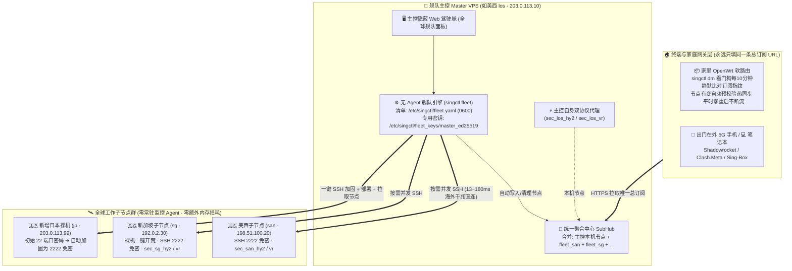

# SingCtl 多节点全球舰队与软路由全自动闭环解说指南

> **适用人群**：拥有 **2 台及以上不同国家/地区 VPS**（例如美西 + 新加坡 + 日本），并且家里部署了 **OpenWrt 软路由（或全屋透明网关）**、出门使用 **5G 手机/笔记本**，希望彻底告别“每买一台新机器重复敲一堆命令、改一次密码到处复制粘贴订阅”的进阶玩家。

---

## 一、 核心架构：一主多从 + 软路由无感跟随

在多节点舰队架构中，我们把设备清晰划分为三个角色：**司令部（Master 主控 VPS）**、**前线节点（Worker 子节点 VPS）**、**终端消费者（家里软路由 + 随身手机/电脑）**。



### 为什么推荐「云端 VPS 当 Master + 家里软路由自动跟随」，而不是拿家里软路由当 Master？

| 对比维度 | **云端 VPS 当 Master（推荐黄金架构）** | **家里软路由当 Master** |
| :--- | :--- | :--- |
| **📱 出门在外 5G 手机体验** | **极佳**：自带公网 HTTPS 域名与正式证书，出门在外用流量随时一键拉取全网所有节点 | **痛点**：家庭宽带无公网 443 端口，人在外面手机根本拉不到家里软路由的订阅 |
| **🌐 开荒速度与救灾抗封锁** | **极佳**：海外机房互连仅十几个毫秒、GitHub 千兆直连（~40 秒开荒一台新机），**完全不受国内晚高峰丢包或跨境阻断影响** | **脆弱**：跨国直连 SSH 易受晚高峰 QoS/阻断影响，最需要换密码救灾时反而可能连不出去 |
| **🖥️ 随时随地可视化管控** | 在公司或旅途中打开主控隐蔽 HTTPS 面板即可巡检、换密码、加机器 | 必须人在家里内网（或先套娃拨通回家 VPN）才能操作 |
| **🔄 软路由同步体验** | 内置 `singctl dm` 看门狗订阅指纹热同步，主控改完后软路由自动静默生效，平时零干预 | 本地直接生成重载 |

---

## 二、 舰队搭建全流程（四步到位）

> [!IMPORTANT]
> **防晕口诀：所有 `singctl fleet`（简写 `singctl fl`）命令 100% 只在 Master 主控这一台机器上执行！** 子节点 VPS 和家里软路由上完全不需要敲任何 `fleet` 命令。

### 第一步：选定 1 台稳定 VPS 作为 Master 主控

挑选你手头线路最稳、续费周期最长的一台 VPS（例如 `los`）按[《单节点指南》](./guide-single-node.md)完成常规部署。它既是你的主力代理节点之一，也同时兼任舰队司令部与统一订阅中心（`SubHub`）。

### 第二步：新买一台空白裸机 VPS？一条命令开荒到底（`fl bootstrap`）

假设你刚买了一台全新的日本 Debian 12 裸机（IP `203.0.113.99`，初始默认是 **SSH 22 端口 + root 密码登录**），只需在 Cloudflare 把 `jp1.example.com` 解析到 `203.0.113.99`，然后登录 **Master 主控**执行这一条命令（或者在主控 Web 后台「全球舰队 -> 裸机 60s 部署纳管」填表提交）：

```bash
singctl fl bootstrap jp \
  --name "日本东京主力" \
  --host 203.0.113.99 \
  --port 22 \
  --password '新机初始Root密码' \
  --domain jp1.example.com \
  --cf-token '你的Cloudflare_DNS_Token' \
  --tag jp
```

#### 这一条命令在后台自动帮你干了哪 4 件大事？（约 40～60 秒）

1. **自动生成并注入“双公钥”（防锁死你自己的电脑）**：
   - 主控自动检查或生成专用管理密钥 `/etc/singctl/fleet_keys/master_ed25519`（`0600` 权限）；
   - 同时自动读取主控自身 `~/.ssh/authorized_keys` 里的管理员公钥（也就是你平时登录主控用的 Mac/PC 电脑公钥，也可通过 `--extra-pubkey` 追加），一并免密写入新机器！
2. **双端口防失联切换 `22 → 2222` 并彻底禁用密码登录**：
   - 自动在 `ufw` / `firewalld` / `SELinux` 放行 `2222` 端口（并置顶放行主控 IP 防误封）；
   - 先让 `sshd` 同时监听 `22` 和 `2222`，**由主控从外部真实发起 `2222` 端口纯密钥免密连接验证**：
     - 若新机云厂商控制台安全组忘了开 `TCP 2222` 导致验证不通，**立即自动回滚保留 22 端口与密码登录**，绝不锁死服务器！
     - 验证一旦通过，立即关闭 `22` 端口、关闭 `PasswordAuthentication`，完成铜墙铁壁加固。
3. **零明文密码落盘（写入人类可读 `fleet.yaml`）**：
   - 初始 root 密码在内存中用完即焚，**绝不写入磁盘**；`/etc/singctl/fleet.yaml` 直接以 `port: 2222` + `auth_type: key_file` 记录该节点。
4. **全自动部署四核代理并汇入总订阅**：
   - 自动下载校验最新版 `SingCtl`（SHA-256 校验），开启 BBR、部署 WARP、申请 Let's Encrypt 证书、启动 Sing-Box（Hysteria2 + Reality）与本地遥测，并自动提取生成的 2 个日本节点写入主控 `SubHub`（标记为 `fleet_jp`）！

### 第三步：手里已有装好 SingCtl 的存量老机器？直接无损收编（`fl add`）

如果某台老机器（如 `198.51.100.20`，已加固在 `2222` 端口）以前装过 `SingCtl`，不需要重装，只需把主控 `/etc/singctl/fleet_keys/master_ed25519.pub` 公钥加进老机器的 `~/.ssh/authorized_keys`，然后在 Master 上执行：

```bash
singctl fl add san \
  --name "美西圣何塞" \
  --host 198.51.100.20 \
  --port 2222 \
  --key /etc/singctl/fleet_keys/master_ed25519
```

1 秒钟内，老机器的 `HY2 + Reality` 节点就会被原封不动提取并合并进 Master 的总订阅池。

### 第四步：家里软路由与手机统一接入唯一总订阅

在你的 OpenWrt 软路由（`/etc/singctl/singctl.yaml`）和手机 App 里，**永远只需要保留 Master 主控这一条订阅链接**：

```yaml
subs:
  - name: master
    url: "https://los.example.com/<主控订阅密钥>/download/collection/all"
    skip_tls_verify: false
    remove-emoji: true

watchdog:
  interval: 180            # 每 3 分钟检查代理健康度
  confirm_wait: 30
  max_restarts: 3
  sub_sync_interval: 600   # 每 10 分钟静默比对订阅节点指纹，有变自动热同步（设 -1 可关闭）
```

在软路由上启动服务后即可彻底放手：
```bash
singctl sb start
singctl web start
```

---

## 三、 人类可读的 `/etc/singctl/fleet.yaml` 结构解析

所有纳管的子节点信息都保存在主控的 `/etc/singctl/fleet.yaml`（严格锁定 `0600` 权限；若从旧版升级，原有的 `fleet.json` 会在首次启动时自动无损迁移为 `fleet.yaml` 并清理旧文件）：

```yaml
# SingCtl 全球节点舰队清单 (由 singctl fleet 自动维护，支持人工查阅编辑，请保持 0600 权限)
version: "1"
nodes:
  - id: san
    name: 美西圣何塞
    host: 198.51.100.20
    port: 2222
    user: root
    auth_type: key_file
    key_path: /etc/singctl/fleet_keys/master_ed25519
    enabled: true
    online: true
    latency_ms: 13
    singctl_version: v1.14.33
    doctor_score: 100
    doctor_summary: 健康指数 100 / 100
    bbr_enabled: true
    synced_nodes: 2
    protocols:
      - hy2
      - vless_reality
  - id: jp
    name: 日本东京主力
    host: 203.0.113.99
    port: 2222
    user: root
    auth_type: key_file
    key_path: /etc/singctl/fleet_keys/master_ed25519
    enabled: true
    online: true
    latency_ms: 105
    singctl_version: v1.14.33
    doctor_score: 100
    synced_nodes: 2
    protocols:
      - hy2
      - vless_reality
```

---

## 四、 日常集中运维高频操作速查

全部操作既可以在 **Master Web 面板 ->「全球舰队」** 点按钮完成，也可以在 Master 终端一行命令搞定：

| 你的运维意图 | 在 Master 上执行的命令 | 软路由与客户端会发生什么？ |
| :--- | :--- | :--- |
| **看全网在线状态、延迟与健康分** | `singctl fl ls` | 无影响（纯只读展示） |
| **并发给所有子节点做深度体检** | `singctl fl doc`（加 `-v` 看完整报告） | 无影响（并发检查证书、BBR、流媒体解锁） |
| **全网一键换密码/换密钥救灾** | `singctl fl reset`（或单台 `singctl fl reset jp`） | 主控自动收回新链接更新订阅池；家里软路由看门狗检测到节点指纹变更后**自动预校验并无感热重载** |
| **发新版本后全网一键升级** | `singctl fl up` | 所有子节点并发升级重启服务，主控同步最新版本号 |
| **某台 VPS 到期不续费下线** | `singctl fl rm jp` | 自动从 `fleet.yaml` 除名，并自动从总订阅池删除 `fleet_jp` 废节点 |
| **看主控自己本机的状态/换密码** | `singctl sr doc` / `singctl sr top` / `singctl sr reset sb && singctl sr sync` | `fl` 管名下子节点，`sr` 管主控本机，职责分明 |

---

## 五、 软路由“无感自动热同步”背后的安全保障（为什么绝不断网？）

家里软路由上的 `singctl dm` 看门狗默认每 10 分钟（`sub_sync_interval: 600`）在后台做一次极轻量的节点指纹比对，遵循**四重不断网铁律**：

1. **平时节点没变（99.9% 的时间）**：提取代理出站列表计算规范化 SHA-256 指纹，发现与本机一致 → **零磁盘写入、零进程重启、游戏/视频连接零闪断**。
2. **主控维护中或订阅链接失效（如 404/502/返回 0 节点）**：直接静默跳过本次同步，**100% 保留软路由当前正在工作的 `config.json`**，绝不拿空配置覆盖好配置。
3. **节点真正变化时先过 `sing-box check` 门禁**：当你在主控新增了日本机（`6 → 8` 个节点）或执行了 `fl reset` 换了密码，软路由先在临时文件生成配置、绑定本地 46+ 规则集缓存并跑 `sing-box check` 语法检查，不通过绝不切换。
4. **保持你的手动分流选择 + 失败自动回滚**：重载前自动快照 Clash API 中你手动选定的策略组（如 `DIY-Node`、`OpenAI`），重载并探活通过后自动恢复原选择；若探活异常则秒级回滚上一份配置。

*(提示：如果你刚在主控加完新机器，不想等 10 分钟看门狗自动周期，想下一秒立刻在软路由体验新节点，随时在软路由面板 `http://192.168.1.1:8090` 点一下「生成配置 + 重启」，或跑 `singctl sb gen && singctl sb restart` 即可立即生效。)*

---

## 六、 进阶问答：主控换 IP、换机器或防盗刷换密钥怎么办？

1. **Q：如果 Master 主控 VPS 被墙换了机房 IP，甚至我换了一台新 VPS 当 Master，软路由和手机要改订阅链接吗？**
   **A：完全不用改！** 因为订阅链接绑定的是你的 Cloudflare 域名与 `/etc/sub-store/key`。换机器时只需把旧主控的 `/etc/singctl/` 与 `/etc/sub-store/` 打包迁到新主控，再把 Cloudflare 域名 A 记录切到新 IP，软路由与所有手机里的订阅 URL **一字不变**无缝接管。
2. **Q：什么情况下才需要去软路由改一次订阅链接？**
   **A：只有你在主控「防盗刷审计表」发现外人盗用订阅、主动点击「轮换密钥」踢人时**。出于安全设计，旧密钥作废后不会自动下发新密钥（否则盗刷者也会自动拿到新密钥）；此时软路由现有连接依然不会断网，你只需从容打开软路由内网面板 `http://192.168.1.1:8090`，把唯一那条订阅 URL 粘贴成新链接保存即可。
