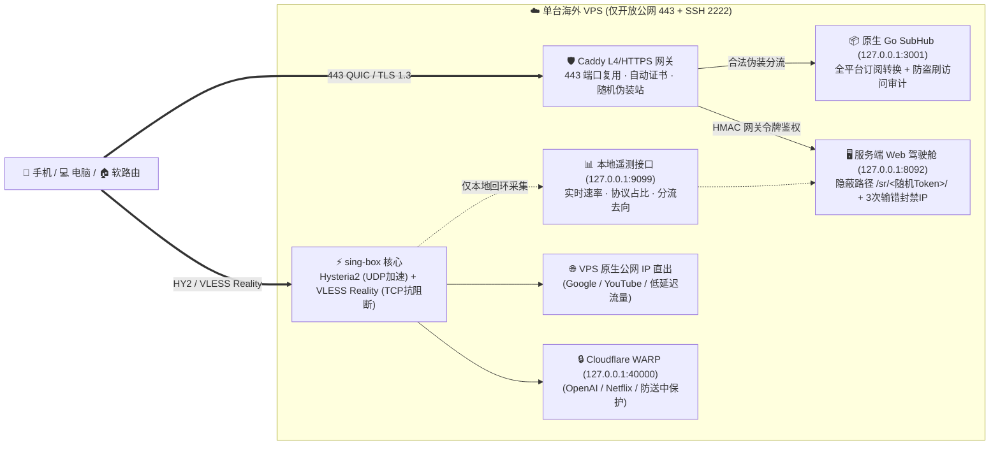

# SingCtl 单节点 VPS 全流程实战解说指南

> **适用人群**：手里只有 **1 台主力海外 VPS**（如 512MB～1GB 内存的 Debian 12 / Ubuntu 22.04+），希望用最少内存、最简单命令获得「抗探测双协议 + 原生/WARP 智能双出口 + 隐蔽可视化面板 + 多端通用订阅」的个人或极客用户。

---

## 一、 单节点架构全景：这台 VPS 里面到底跑了什么？

`SingCtl` 摒弃了传统方案里臃肿的 Docker 容器与外部数据库，以**单二进制 + 四大轻量原生组件**协同工作，整机业务常驻内存仅约 **45～70 MB**（1GB 小内存机型也能常年稳定运行）：



### 核心设计亮点
1. **公网零多余端口暴露**：`SubHub`（`3001`）、`ServerWeb`（`8092`）、`WARP`（`40000`）与实时遥测（`9099`）全部严格绑定 `127.0.0.1` 本地回环，公网扫描器探测 `443` 端口只会看到一个逼真的静态技术博客伪装站。
2. **双协议互补不断联**：
   - **Hysteria 2（基于 QUIC/UDP）**：晚高峰跨国丢包环境下暴力抢占带宽，跑满家宽油管 4K/8K。
   - **VLESS-Vision-Reality（基于 TCP/TLS 1.3）**：遇到运营商对 UDP 限速或 QoS 时，无缝兜底，握手特征与访问苹果官方 CDN 无异。
3. **双出口智能分流**：普通网页与视频走 VPS 原生高速线路；遇到容易封禁机房 IP 的 AI 服务（如 ChatGPT/Claude）或流媒体解锁需求时，自动分流至本机 `wireproxy` WARP 干净出口。

---

## 二、 准备工作（3 分钟）

1. **一台干净的 Linux 云服务器**：推荐 **Debian 12** 或 **Ubuntu 22.04 / 24.04**。
2. **一个托管在 Cloudflare 的域名**：
   - 在 Cloudflare DNS 中添加一条 `A` 记录（例如 `node.example.com` -> 指向 VPS 公网 IP `203.0.113.10`，**关闭小黄云仅保留灰色 DNS Only**）。
   - 在 Cloudflare「我的个人资料 -> API 令牌」创建一个具备 **区域 - DNS - 编辑** 权限的 API Token（用于 Caddy 自动申请通配/DNS-01 证书，无需依赖 80 端口验证）。

---

## 三、 第一步：SSH 安全基线加固（推荐必做）

刚买回来的新 VPS 默认开着 `22` 端口密码登录，每天会被全网机器人成千上万次暴力撞库。可以在你本地电脑（Mac / Linux / Windows）用 `singctl ssh` 先给它做一键无损加固：

```bash
# 1. 在本地目录生成 ssh-init.yaml 模板
singctl ssh tpl

# 2. 编辑 ssh-init.yaml，填入 VPS IP (如 203.0.113.10) 与初始 root 密码
# 3. 一键执行：自动推公钥 -> 验证免密 -> 双端口平滑切 2222 -> 禁用密码登录 -> 写入 ~/.ssh/config
singctl ssh init
```

> [!TIP]
> `singctl ssh init` 内置**双端口过渡防锁死机制**：如果云厂商网页安全组忘了放行 `TCP 2222`，外部免密探测失败时会自动回滚保留 `22` 端口，绝不会把你锁在服务器外面。

---

## 四、 第二步：一键部署四核服务端

SSH 登录到你的 VPS 后，只需一行命令即可启动交互式安装向导：

```bash
curl -fsSL https://raw.githubusercontent.com/sixban6/singctl/main/install.sh | sh
```

选择 **`1) 服务端部署 (Server)`**，按提示依次输入：
1. **节点绑定域名**：例如 `node.example.com`
2. **Cloudflare DNS API Token**：粘贴刚才创建的 Token
3. **节点地区代号（可选）**：例如 `sg`、`jp`、`us`（留空则自动根据公网 IP 识别）

如果你更喜欢非交互式配置，也可以先编辑 `/etc/singctl/singctl.yaml`（权限自动保护为 `0600`），然后执行：

```bash
singctl sr install
```

约 **30～60 秒**后，安装完毕！终端会直接打印出：
- 🖥️ **隐蔽管理面板地址**：`https://node.example.com/sr/<16位随机安全路径>/`
- 🔑 **初始随机管理员账号与强密码**（首次登录网页确认保存后自动销毁明文提示）
- 📡 **全平台通用聚合订阅地址**：`https://node.example.com/<随机密钥>/download/collection/all`

---

## 五、 第三步：日常可视化与命令行运维怎么用？

### 1. 打开隐蔽 Web 驾驶舱（零命令点点鼠标）

浏览器打开安装结束给出的 `https://node.example.com/sr/<随机路径>/` 登录后，你将拥有 6 大运维视图：
- **总览驾驶舱**：实时上下行网速动态波形图、`Hysteria2 / Reality` 协议负载条、`原生直出 / WARP` 分流占比、当前活跃访问域名 Top 8，以及一键重生成伪装站、更换安全路径等快捷开关。
- **核心服务控制**：独立查看、重启、升级 `sing-box`、`Caddy`、`SubHub`、`WARP` 四大核心服务，在线检视配置。
- **节点与订阅分发**：一键扫码或复制 **Shadowrocket / Clash.Meta / Sing-Box / Surge / Loon** 专属订阅链接；底部自带**订阅拉取防盗刷审计表**（记录每次拉取的时间、脱敏 IP、国家地区与客户端类型）。
- **网络回程与流媒体诊断**：一键跑三网（电信/联通/移动）回程路由分析（识别 CN2 GIA / 9929 / CMI）及 Netflix / YouTube / OpenAI 解锁体检。
- **安全与防爆破审计**：查看输错 3 次密码被自动封禁的攻击者 IP，支持手动解封与查看完整管理操作审计日志。

### 2. 终端高频运维三剑客（SSH 登录 VPS 后使用）

```bash
# ① 实时路况大屏（类似 htop，秒级滚动看谁在连、跑多快、走直出还是 WARP）
singctl sr top
singctl sr top --once      # 打印单次快照即退出

# ② 10 项全链路健康体检（满分 100 分，查证书剩余天数、BBR、Reality 握手、双出口画像）
singctl sr doctor

# ③ 一键重置节点密码与密钥（怀疑节点链接泄露时，重生成 UUID/Reality密钥/HY2密码并自动同步订阅）
singctl sr reset sb && singctl sr sync
```

---

## 六、 第四步：各终端客户端如何接入？

无论你有多少台手机、电脑或软路由，都只需要用上面那**同一条订阅链接**：

1. **iPhone / iPad / Android 手机**：
   - **Shadowrocket / Stash / Clash Meta for Android**：直接打开服务端 Web 面板「节点与订阅分发」，点对应图标一键唤起导入或扫码添加。
   - **sing-box 官方客户端 (SFI/SFA)**：若家里装了客户端/软路由，也可直接扫软路由 WebUI 生成的 iOS 配置码。
2. **Mac / Windows / Linux 桌面或 OpenWrt 软路由**：
   在客户端机器的 `/etc/singctl/singctl.yaml` 中填入订阅链接：
   ```yaml
   subs:
     - name: main
       url: "https://node.example.com/<订阅密钥>/download/collection/all"
       skip_tls_verify: false
       remove-emoji: true
   ```
   然后执行：
   ```bash
   singctl sb start     # 自动拉取订阅、本地化 46+ 分流规则集、启动透明代理与看门狗守护进程
   singctl web start    # 启动本地内网控制面板 (默认 :8090)，浏览器随时切节点、测速、看日志
   ```

---

## 七、 常见问题与安全锦囊

- **怀疑订阅地址泄露给别人了怎么办？**
  进入服务端 Web 面板 →「节点与订阅分发」查看底部**防盗刷审计表**。若发现陌生地区 IP 或陌生客户端拉取，直接点击右上角 **「轮换密钥」**：旧订阅 URL 立即返回 `404` 作废，同时你可以选择连带执行 `singctl sr reset sb` 把底层节点密码一起换掉。
- **服务器怎么升级到最新正式版？**
  登录 VPS 执行 `singctl update self && systemctl restart singctl-sub && singctl sr web restart`，或在服务端面板直接检查更新。
- **什么时候该从“单节点”升级到“多节点舰队”？**
  只要你手里有了 **第 2 台 VPS**（比如想加一台美西备用机或日本低延迟机），无需改动现有单节点配置——它可以直接原地晋升为**舰队主控（Master）**！具体操作请继续阅读姊妹篇 👉 **[《多节点全球舰队与软路由全自动闭环解说指南》](./guide-multi-node-fleet.md)**。
