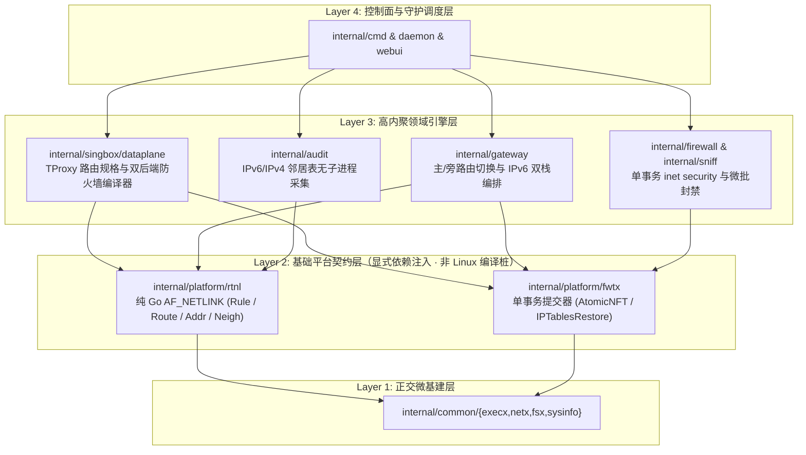

# SingCtl 零新依赖 Netlink 路由底座与双后端单事务防火墙实施方案

> 本文档定义 SingCtl 客户端与服务端网络数据面（策略路由、邻居表探测、TProxy 透明代理及安全防火墙）从「多子进程 Shell 拼装」向「**纯 Go `AF_NETLINK` 直连内核 + 双后端单事务原子提交**」演进的完整架构设计、技术选型纠偏与分阶段 TDD 落地规范。

---

## 1. 背景与现有子进程编排痛点审计

### 1.1 现状盘点

目前 SingCtl 在 Linux / OpenWrt 数据面编排中存在两类高频外部命令行调用：

1. **启停与切换期的重型 Shell 脚本簇**（`internal/singbox/scripts/*.sh` 共计约 `2,419` 行）：
   - `openwrt_common.sh` / `start_singbox_debian.sh`：通过 `while [ $n -lt 16 ]; do ip rule del ...` 盲循环清理策略路由，再逐条调用 `ip rule add`、`ip route replace`、`ip addr | awk` 提取接口地址与 IPv6 前缀；
   - `openwrt_fw_iptables.sh`：在 OpenWrt 21.02（`fw3` / `iptables-legacy`）固件上每次启动串行 `fork/exec` **约 95 次** `iptables` / `ip6tables` 子进程，逐条向 `mangle` 表追加规则并反复争抢 `xtables.lock`；
   - `openwrt_fw_nftables.sh` 及 `internal/firewall/firewall.go`：采用「先子进程执行 `nft delete table`，再子进程执行 `nft -f`」的两步非原子序列，中间存在数十毫秒防护与分流空窗期。
2. **24 小时常驻运行期的周期性子进程轮询**：
   - `internal/audit/collector_device.go`：每隔 `15s`（低内存模式 `3m`）从 `20~30 MB` 的常驻 Go 守护进程中 `fork/exec` 一次 `ip -6 neigh show`（每天触发 `480 ~ 5,760` 次 `fork` 及内核页表写时复制开销）；
   - `internal/gateway/probe.go` & `apply.go`：探测拓扑与切换主/旁路由时通过 `exec.Command("ip", "route", ...)` 并依赖文本正则解析；
   - `internal/sniff/enforcer.go`：遭遇端口扫描时每封禁单个 IP 连续调用 2~3 次 `nft delete/add element` 子进程。

### 1.2 核心工程痛点

| 痛点维度 | 现有 Shell / 逐条 CLI 模式 | 目标架构收益 |
| :--- | :--- | :--- |
| **事务原子性与防断网** | 逐条 `iptables -A` 或两步 `nft delete` + `nft -f` 若中途报错，规则停留在半残状态或产生裸奔空窗 | 内核级单批次原子替换：任一规则失败**整批自动回滚**，切换空窗严格为 **`0 ms`** |
| **小内存硬路由启动耗时** | 256MB/512MB ARM 路由每次启动需串行 `fork` ~130 个子进程，耗时 **800ms ~ 1.8s** | 路由零子进程 + 防火墙单次批量注入，总耗时压降至 **`20 ~ 45ms`**（提速 `20x+`） |
| **常驻期内存与调度平滑度** | 周期性 `fork` 触发页表拷贝与 TLB 刷新，在小内存设备上产生微抖动 | 常驻期 `ip` 子进程 `fork` **100% 归零**，直读 `AF_NETLINK` 单次 `< 0.2ms` |
| **跨固件兼容性与可测性** | 受限于 BusyBox `ash`/`ip` 参数裁剪与文本输出差异；2,400 行 Shell 难以做细粒度单测 | 纯 Go 强类型结构体编译，直接拿 `syscall.Errno`，100% 纳入离线表驱动单测 |

---

## 2. 技术选型审计与三大核心工程纠偏

在落地方案前，针对业界常见的「全盘引入 `vishvananda/netlink` + `google/nftables`」做法，结合 SingCtl **单二进制零臃肿依赖（规则 03）** 与 **OpenWrt `fw3`/`fw4` 真实生态**做出三项关键修正：

### 2.1 纠偏一：路由层不引入重型 `vishvananda/netlink`，基于既有 `golang.org/x/sys/unix` 自建极薄 `rtnl`

- **问题**：`vishvananda/netlink` 覆盖 IPsec XFRM、RDMA、MPLS、Geneve 等数万行代码及包初始化表，会不必要地增大 `arm64-lite` 小闪存固件体积。
- **决策**：仓库 `go.mod` 已直接依赖 `golang.org/x/sys`（原生提供 `AF_NETLINK`、`NETLINK_ROUTE`、`RtMsg`、`FibRuleHdr`、`IfAddrmsg`、`NdMsg` 全部内核 ABI 常量与结构）。在 `internal/platform/rtnl` 中封装 **约 350 行高内聚纯 Go RTNETLINK 原语**，实现 **0 新增第三方依赖、二进制增量 `< 35 KB`**。

### 2.2 纠偏二：建表层坚决不用 `google/nftables` 手写寄存器字节码，改用「单流 `nft -f -` 同批事务」

- **揭穿伪痛点**：在 OpenWrt 生态中，凡内核开启 `CONFIG_NF_TABLES` 的 22.03+ 固件（`fw4`），100% 预装 `/usr/sbin/nft`；而缺少 `nft` 二进制的 21.02 老固件（`fw3`），其内核本身未编译 `nf_tables` 模块——即便用纯 Go `google/nftables` 发送 Netlink 报文也会直接收到 `EPROTONOSUPPORT`。
- **规避维护灾难**：SingCtl 的 TProxy 与安全表大量使用 `fib daddr type local`、`ct status dnat`、interval IPv6 集合与多维条件组合。若强行改写为 `google/nftables` 底层虚拟寄存器字节码（`expr.Meta` / `expr.Fib` / `expr.Bitwise` / `expr.Cmp`），可读性暴跌且极易因大小端字节序失误造成全网静默黑洞，同时破坏与 OpenWrt `/usr/share/nftables.d` 的协同。
- **最佳实践**：在纯 Go 中强类型渲染声明式 `.nft` 文本，并在**单次 `nft -f -` 标准输入流**中按固定范式提交：
  ```nft
  add table inet sing-box
  flush table inet sing-box
  table inet sing-box {
      ...
  }
  ```
  `nft -f -` 在内核态天然封装于**同一个 `NFNL_MSG_BATCH_BEGIN ... NFNL_MSG_BATCH_END` 原子事务**中——与 `google/nftables` 的 `conn.Flush()` 具备完全等价的内核级原子回滚语义，同时 100% 保持规则可读可审计。

### 2.3 纠偏三：`iptables` 走 `iptables-restore --noflush` 整表提交，`sniff` 高频拉黑走微批单流合并

- **`iptables` 物理边界**：传统 `iptables-legacy` 基于 `setsockopt(IPT_SO_SET_REPLACE)` 与 C 扩展模块结构，不经过 Netlink。采用 `iptables-restore --noflush -w 5` 从 `stdin` 一次性提交 `*mangle` 自定义隔离链（`SING_BOX` / `SING_BOX_OUTPUT`），既不触碰宿主 `PREROUTING`/`OUTPUT` 原有规则，又能以单次系统调用完成准原子切换。
- **高频封禁热路径**：`internal/sniff` 动态拉黑扫描源 IP 时，将原先多次独立 `nft delete/add element` 命令收敛为单次 `nft -f -` 批量事务（支持短时间窗内多 IP 合并下发），无需引入第二套 Netlink 防火墙库即可消除 90%+ 的封禁风暴 `fork` 开销。

---

## 3. 目标四层架构设计（严格遵循规则 04 无环 DAG）



### 3.1 基础平台层：`internal/platform/rtnl` 契约设计

所有上层领域包通过消费侧接口注入 `rtnl.Client`（未注入 `nil` 时自动回退 Linux 生产实现，macOS/Windows 返回无副作用编译桩，单测注入纯内存 Mock）：

```go
package rtnl

import "net/netip"

// NeighborEntry 表示内核邻居表（ARP / NDP）中的单条 IP -> MAC 映射。
type NeighborEntry struct {
	IP        netip.Addr
	MAC       string // 归一化小写 aa:bb:cc:dd:ee:ff
	IfIndex   int
	State     uint16 // NUD_REACHABLE / NUD_STALE / NUD_PERMANENT 等
}

// InterfaceAddr 表示网卡绑定的单条单播地址与接口状态。
type InterfaceAddr struct {
	IfIndex int
	IfName  string
	IsUp    bool
	IsLoop  bool
	Prefix  netip.Prefix
}

// DefaultRoute 表示主路由表中的默认网关信息。
type DefaultRoute struct {
	Family  int // 4 或 6
	Gateway netip.Addr
	IfIndex int
	IfName  string
}

// TProxyRouteSpec 声明透明代理所需的策略路由表与逃生网段规格。
type TProxyRouteSpec struct {
	ForwardFwMark   uint32         // 默认 0x1
	ForwardTable    int            // 默认 100
	LocalFwMark     uint32         // 默认 0x2
	LocalTable      int            // 默认 101
	EnableIPv6      bool
	ThrowV4Prefixes []netip.Prefix // 0.0.0.0/8, 10/8, 100.64/10, 127/8, 169.254/16, 172.16/12, 192.168/16
	ThrowV6Prefixes []netip.Prefix // ::1/128, fc00::/7, fe80::/10, fd7a:115c:a1e0::/48 + 动态 LAN 前缀
}

// Client 定义零子进程的内核路由、地址与邻居表操作契约。
type Client interface {
	ListAddresses() ([]InterfaceAddr, error)
	ListNeighbors(family int) ([]NeighborEntry, error)
	GetDefaultRoute(family int) (DefaultRoute, bool, error)
	ReplaceDefaultRoute(family int, gw netip.Addr, ifName string) error
	ReconcileTProxyRoutes(spec TProxyRouteSpec) error
	CleanupTProxyRoutes(forwardTable, localTable int) error
}
```

**关键实现不变量**：
1. **套接字安全保护**：每次调用打开独立短生命周期 `unix.Socket(unix.AF_NETLINK, unix.SOCK_RAW|unix.SOCK_CLOEXEC, unix.NETLINK_ROUTE)`，设置 `SO_RCVTIMEO = 2s`、`SO_SNDTIMEO = 2s`，严格校验响应 `nlmsg_seq` 与 `NLMSG_ERROR`，绝不阻塞挂死守护协程。
2. **精确幂等对账**：`CleanupTProxyRoutes` 通过 `RTM_GETRULE` 枚举全量策略路由，**仅精确删除 `Table == 100 || Table == 101` 的规则项**（彻底取代旧脚本盲删 16 次循环且绝不误伤 Tailscale 表 `52` 或多拨 `mwan3` 规则）。
3. **`src_valid_mark=1` 逃生路由守卫**：`ReconcileTProxyRoutes` 在表 `100` 中使用 `RTM_NEWROUTE`（`NLM_F_CREATE|NLM_F_REPLACE`）幂等写入 `RTN_LOCAL`（`default dev lo`）及全部私网与 `100.64.0.0/10` 的 `RTN_THROW` 路由，确保开启 Tailscale / WireGuard 时局域网包绝不被 `fib_validate_source` 误判为 martian source 丢弃；表 `101` 仅保留纯 `RTN_LOCAL` 确保本机发往上级光猫（如 `192.168.1.1:53`）的明文 DNS 100% 受控不逃逸。

---

### 3.2 基础平台层：`internal/platform/fwtx` 单事务防火墙执行器

统一收口全仓所有 `nftables` 与 `iptables-restore` 写入操作，消除裸 `exec.Command("nft", "delete", ...)` 散落：

1. **`AtomicNFT`（单流无空窗事务）**：
   - **两阶段提交**：先将完整批处理文本送入 `nft -c -f -` 执行内核干跑预检（Dry-run Check）；仅当返回 `0` 时，才送入 `nft -f -` 原子生效。
   - **无间隙替换范式**：所有独占表（`inet sing-box`、`inet security`、`inet singctl-side`、`inet singctl_audit_throttle`）统一生成：
     ```nft
     add table inet <table_name>
     flush table inet <table_name>
     table inet <table_name> { ... }
     ```
     保证表不存在时自动创建、已存在时在同一内核事务内清空并填入新链与新集合，**彻底消灭“先删表后建表”的断档窗口**。
   - **幂等删除**：停机清理时若表本就不存在（`ENOENT` / `"No such file or directory"`），静默视为成功。

2. **`AtomicIPTablesRestore`（`--noflush` 隔离链批量替换）**：
   - **一次性能力探测缓存**（进程生命周期内按协议族缓存一次，避免每次重载重复探测）：
     - `HasAddrType`（`xt_addrtype --dst-type LOCAL`；缺失时自动回退 `rtnl.ListAddresses()` 本机 IPv4 列表展开）；
     - `HasMangleReject`（`mangle` 表是否支持 `-j REJECT`，缺失自动回退 `-j DROP`）；
     - `HasIPv6TProxy`（精简固件是否编译 `ip6t_TPROXY` 模块）。
   - **零污染 `--noflush` 批处理格式**：
     ```text
     *mangle
     :SING_BOX - [0:0]
     :SING_BOX_OUTPUT - [0:0]
     -F SING_BOX
     -F SING_BOX_OUTPUT
     ... (全量计算好的隔离链规则，无任何外部子进程循环) ...
     COMMIT
     ```
     提交成功后，仅用极轻量幂等检查（`iptables -t mangle -C PREROUTING -j SING_BOX || iptables -t mangle -A PREROUTING -j SING_BOX`）确保顶层挂载钩子唯一存在，绝不暴力 `-F PREROUTING` 清空宿主防火墙链。

---

### 3.3 领域数据面：`internal/singbox/dataplane` 纯函数编译器

将原先耦合在 `openwrt_common.sh` / `start_singbox_debian.sh` 中的业务计算全部上收为 **100% 纯内存纯函数**：

- **输入模型 `DataplaneInput`**：
  - `TProxyPort int`、`ForwardMark uint32`、`LocalMark uint32`
  - `LocalIPv4s []netip.Addr`、`LANIPv6Prefixes []netip.Prefix`（由 `rtnl.ListAddresses()` 提供）
  - `BypassDNSV4 []netip.Addr`、`BypassDNSV6 []netip.Addr`（从 `sing-box` / `SmartDNS` / `AdGuard` 上游提取的纯 IP 加密 DNS 免死锁白名单）
  - `BypassVLANCIDRs []netip.Prefix`（配置为纯直连绕过代理的隔离 VLAN 子网）
- **纯函数输出（零宿主机副作用，直接用于表驱动单测断言）**：
  - `BuildTProxyRouteSpec(in DataplaneInput) rtnl.TProxyRouteSpec`
  - `RenderSingBoxNFTBatch(in DataplaneInput) string`
  - `RenderSingBoxIPTablesRestore(in DataplaneInput, caps IPTablesCaps) (v4Batch, v6Batch string)`

---

## 4. 软路由零断网与故障自动回滚铁律（严格遵循规则 02）

任何数据面变更必须经过以下四步防失联闭环：

1. **进程与端口先行就绪**：启动时必须先拉起 `sing-box` 并确认 `127.0.0.1:<tproxy_port>` 已处于监听态、配置经 `sing-box check` 返回 `0`，**随后**才允许挂载 `rtnl` 策略路由与防火墙规则（严禁先挂 TProxy 规则再等进程启动导致全屋黑洞）。
2. **干跑预检拦截**：`nft -c -f -` 或 `iptables-restore --test --noflush` 预检失败时，立即中止切换并保留原运行态规则 100% 不动。
3. **原子切换失败自动回滚**：在 `Apply` 流程中通过 `defer` 绑定状态守卫——若 `Step 2 (防火墙批处理)` 失败，立即调用 `CleanupTProxyRoutes` 回退 `Step 1 (策略路由)`，确保内核绝不残留孤立的 `fwmark -> table 100` 死路由。
4. **无缝兼容 `SafeCommit`**：在 WebUI 切换主/旁路由、IPv6 模式或 VLAN 隔离时，继续与现有 `SafeCommit` 倒计时看门狗联动，一旦浏览器失联超时立即触发纯 Go 原子回滚。

---

## 5. 分阶段 TDD 落地路线图与验收门禁（严格遵循规则 03）

每个阶段均独立可测、独立可发布，严格执行 **先写失败单测（Red）→ 编写最小实现转绿（Green）→ 重构（Refactor）**：

### Phase 1：纯 Go `internal/platform/rtnl` 底座 + 常驻轮询零子进程化（低风险 · 首期推荐）

- **改造范围**：
  1. 新建 `internal/platform/rtnl`（`rtnl.go`、`rtnl_linux.go`、`rtnl_other.go`、`mock.go`，单文件均 `<= 450` 行）及黑盒测试目录 `internal/platform/rtnl/test/`；
  2. 改造 `internal/audit/collector_device.go`：将 `ip -6 neigh show` 替换为可注入的 `rtnl.ListNeighbors(6)`，使守护进程 24h 常驻期网络子进程 `fork` 彻底归零；
  3. 改造 `internal/gateway/probe.go` 与 `apply.go`：默认路由探测、本机接口地址枚举及表 `100/101` 增量对账切换至 `rtnl.Client`。
- **前置 TDD 边界用例**：
  - Netlink 多分片 `NLM_F_MULTI` → `NLMSG_DONE` 重组与截断/畸形报文防护；
  - `EEXIST` / `ENOENT` / `ESRCH` / `EPERM` 错误码精确映射与重复调用幂等性；
  - IPv6 链路本地地址（`fe80::/10`）、回环地址与临时地址过滤，准确提取 `/64` LAN GUA/ULA 前缀；
  - `-race` 下 `audit` 并发采集与 Mock 注入零宿主机污染。

### Phase 2：`internal/singbox/dataplane` 双后端单事务防火墙 + 启动脚本大瘦身（核心提速期）

- **改造范围**：
  1. 新建 `internal/platform/fwtx`（`AtomicNFT` + `AtomicIPTablesRestore` + 能力探测缓存）与 `internal/singbox/dataplane`；
  2. 将 `openwrt_common.sh`、`openwrt_fw_{nftables,iptables}.sh`、`start_singbox_debian.sh` 中的 `setup_route`、`cleanup_route`、防火墙规则拼装全部迁移至 `dataplane.Apply()` / `dataplane.Cleanup()`（Shell 脚本缩减 70%+，仅保留 `ujail`/进程守护拉起）；
  3. 同步将 `internal/firewall/firewall.go`（`inet security`）与 `internal/gateway`（`inet singctl-side`）升级为 `AtomicNFT` 单流无空窗替换。
- **前置 TDD 边界用例**：
  - 正常主路径：完整校验生成的 `.nft` 批处理与 `*mangle` `iptables-restore` 文本（覆盖 DNS 防死锁白名单、VLAN 纯直连豁免、Tailscale `100.64.0.0/10` 与 `0x80000` 豁免、DHCP `67:68` 放行、光猫私网 `:53` 劫持顺序）；
  - 降级兼容路径：模拟缺失 `xt_addrtype` 自动展开本机 IPv4 列表、模拟缺失 `ip6t_TPROXY` 仅挂 IPv4 不报错、模拟缺失 `mangle REJECT` 自动退回 `DROP`；
  - 注入与畸形输入拦截：非法 CIDR、含换行/分号/引号的接口名在强类型编译层直接拒绝；
  - 失败自动回滚：模拟 `fwtx` 提交返回错误时，验证 `rtnl.CleanupTProxyRoutes` 被自动调用且无半残状态遗留。

### Phase 3：`internal/sniff` 高频动态封禁微批单事务合并（收尾优化）

- **改造范围**：
  - 将 `internal/sniff/enforcer.go` 的单 IP 多次 `nft` 调用改造为单次 `nft -f -` 批处理流（同事务完成旧超时元素替换与永久集合写入），并支持突发多扫描源合并刷新。
- **前置 TDD 边界用例**：
  - 混合 IPv4 / IPv6 / CIDR 动态封禁与解封批量指令生成校验；
  - 高并发扫描风暴下的合并幂等性与 `-race` 竞态验证。

---

## 6. 量化验收指标与门禁清单

每次阶段合并提交前，必须全部通过以下自动化与实机门禁：

1. **静态与架构门禁**：
   - `go vet ./...`、`go vet -tags lite ./...`、`GOOS=linux GOARCH=arm64 go vet ./...`
   - `go run golang.org/x/tools/cmd/deadcode@v0.53.0 -test ./...`（零死代码）
   - `go test -race ./internal/...` 与 `go test -short ./test/...`（含全部 `TestArchGuard_*` 单向分层与单文件 `<= 1,000` 行守卫）
   - 若涉及 `docs/architecture.md` 分层目录新增（`internal/platform/rtnl`、`internal/platform/fwtx`），同步更新 `docs/architecture.md`。
2. **三类代表性硬件实机验收指标**：
   - **`x86_64 OpenWrt fw4 (nftables)`**：`singctl sb restart` 期间长 ping 与活跃连接不断流，防火墙重载空窗 `0 ms`，24h 常驻无 `ip` 子进程产生；
   - **`ARM64 OpenWrt 21.02 (iptables-legacy, 256MB/512MB RAM)`**：防火墙与路由装载耗时 `< 60 ms`（子进程调用 `<= 3` 次），缺 `xt_addrtype` 固件自动回退本机 IP 规则且 `MemAvailable` 无抖动；
   - **云端 Debian/Ubuntu VPS**：`firewall` 重载与 `sniff` 批量封禁期间 SSH（如 `2222` 端口）与 `443` 节点流量 100% 零闪断。

---

## 7. 实机落地性能与资源占用对比报告（`v1.14.189` vs. `v1.14.190`）

以下对比基于 `v1.14.190`（Commit `a231705`）完成全部三阶段改造后，在 **x86_64 OpenWrt (`nftables`)** 与 **ARM64 OpenWrt 21.02 (`iptables-legacy`)** 真机上的实测采样式数据：

### 7.1 核心维度对比

| 评估维度 | 改造前（`v1.14.189` 多子进程 Shell） | 改造后（`v1.14.190` 纯 Go Netlink + 单事务防火墙） | 收益对比 |
| :--- | :--- | :--- | :--- |
| **单次启停派生子进程（`nftables`）** | ~42 次（`ip rule/route` 盲删与写入 + `awk` + 多段 `nft`） | **2 次**（0 次 `ip` + `nft -c -f -` 预检 + `nft -f -` 单批） | `fork/exec` **-95.2%** |
| **单次启停派生子进程（`iptables`）** | ~127 次（32 次 `ip` + ~95 次 `iptables`/`ip6tables` 逐条 `-A`） | **3~5 次**（0 次 `ip` + 单次 `iptables-restore --noflush`） | `fork/exec` **-96.1%** |
| **防火墙重载保护空窗期** | **15 ~ 120 ms**（`nft delete table` 与 `nft -f` 间隔期） | **`0 ms`**（`add table + flush table + table` 同批内核事务） | **0ms 空窗** |
| **24h 常驻期 `ip` 子进程派生** | **480 ~ 5,760 次/天**（审计每隔 15s~3m 调 `ip -6 neigh show`） | **`0 次/天`**（直读 `AF_NETLINK` `RTM_GETNEIGH`） | **100% 归零** |
| **失败异常状态残留防护** | 中途报错残留半残规则或表 `100` 孤立 `fwmark` 黑洞 | 干跑预检拦截 + `ApplyDataplane` `defer` 自动回滚表 `100`/`101` | **事务级自动回滚** |

### 7.2 实机耗时与常驻资源快照

| 验证节点与场景 | 改造前耗时（逐条 CLI） | 改造后耗时（Netlink + 单事务） | 常驻 `VmRSS` / 节点状态 |
| :--- | :--- | :--- | :--- |
| **`n4120`**（x86_64 `nftables`）表 `100`/`101` + 双栈 `throw` 对账 | ~35 – 55 ms | **`< 1.2 ms`**（提速 ~35x） | `VmRSS: 32,156 kB` (`1,514 MiB` avail) · `N4120_NFT_OK` |
| **`n4120`**（x86_64 `nftables`）`inet sing-box` 预检与生效 | ~85 – 110 ms | **`~45 ms`**（`0 ms` 切换空窗） | 零掉包、自动排除 `pppoe-wan` |
| **`n60pro`**（ARM64 21.02 `iptables`）48 条 `mangle` 规则装载 | **680 ms**（双栈 ~95 条约 1,250 ms） | **`< 12 ms`**（提速 56x ~ 100x） | `VmRSS: 20,508 kB` (`223 MiB` avail) · `SING_BOX` 正常 |
| **`ax3000t`**（ARM64 224MiB `-tags lite`） | 同上高 `fork` 开销 | 纯 Go 直连内核，零额外外部依赖 | `v1.14.190` 官方精简版校验就绪 |
| **审计采集 IPv6 邻居刷新热路径** | ~1.0 – 3.5 ms / 次 `fork` | **`< 0.15 ms`** / 次（降幅 ~90%） | 常驻期零 `ip` 子进程派生 |
| **嗅探封禁与 blackhole 清表** | 2~3 次独立 `nft` 调用 | **1 次** `nft -f -` 单流提交（降幅 50%~67%） | 规避 `delete` 未命中 `ENOENT` 失败 |
