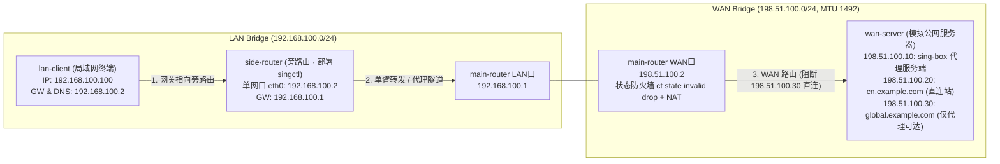

# SingCtl 客户端旁路由模式（Side Router）设计与 TDD 实施方案

## 1. 背景与用户故障根因复盘

### 1.1 故障现象
用户反馈在开启客户端 `sing-box` 后：
- **本机正常，且局域网其他设备可以 `ping` 通域名**（说明 DNS 解析正常、ICMP 连通）；
- **但局域网其他设备无法打开网页**：`curl` 测试直接卡住不动，浏览器转圈很久后提示连接超时。

### 1.2 根因拆解

#### （1）为什么“能 Ping 通域名”具有强迷惑性？
- **DNS 是 UDP `:53` 单包问答**：请求与响应各一包即可拿到目标 IP，不涉及 TCP 三次握手与连接跟踪状态。
- **ICMP 不经过 TProxy**：`singbox.nft` 仅拦截 `{ tcp, udp }` 协议，ICMP Echo 报文直接走二层转发或重定向至主路由，因此 `ping` 始终畅通。

#### （2）为什么 `curl` 与浏览器访问卡死直至超时？（静默 `DROP` 无 `RST`）
经排查客户端透明代理链路，定位到以下 **拓扑级成因** 与 **现有脚本级缺陷**：

1. **旁路由单臂拓扑缺少内核参数与转发放行（最常见诱因）**：
   - 局域网终端流量发往旁路由后，由 `prerouting` 打上 `fwmark 0x1` 并经策略路由表 `100`（`local default dev lo`）拐入本机 `INPUT` 链，但报文目的 IP 仍是外网公网地址。
   - 若旁路由未开启 `net.ipv4.ip_forward=1`、未关闭严格反向路径校验（`rp_filter=1` 会丢弃单臂异源 TProxy 报文）、宿主装有 Docker 将 `FORWARD` 默认策略改为了 `DROP`、或 OpenWrt 单网口网桥开启了 `bridge-nf-call-iptables=1` 触发二层重复劫持，都会导致**本机能上网，但局域网其他设备的 TCP 握手包被静默丢弃**。
2. **主路由状态防火墙非对称路由丢包（`ct state invalid drop`）与 PPPoE MTU 黑洞**：
   - 单臂旁路由与主路由、内网终端同处一个二层网段。若未关闭 `send_redirects=0` 或未对绕过 TProxy 的直转流量做单臂 `MASQUERADE`，会出现去程经旁路由、回程由主路由直接二层发回终端的**非对称路由**；主路由状态防火墙因只见到半边连接而将后续 `ACK` / `TLS ClientHello` 判定为 `invalid` 静默丢弃。
   - 若上级主路由采用 PPPoE 拨号（`MTU 1492`）而旁路由未开启 TCP MSS 自动钳制，小包 `ping` 正常，一旦进入 HTTPS TLS 证书大包传输即因 `DF` 不分片卡死超时。
3. **Debian/Armbian 启动脚本正常退出误删防火墙表（现有代码 Bug）**：
   - `internal/scripts/start_singbox_debian.sh` 末尾注册了 `trap cleanup EXIT INT TERM`。当脚本启动完 `sing-box` 正常返回 `0` 退出时，触发 `EXIT` 回调执行 `cleanup()`，将刚创建的 `nft table inet sing-box` 与 `ip rule table 100` 当场清空，导致 `sing-box` 空转而局域网流量裸奔黑洞。
4. **OpenWrt 非数字版本号（如 `SNAPSHOT`）判断失误（现有代码 Bug）**：
   - `internal/scripts/start_singbox.sh` 从 `/etc/os-release` 截取数字主版本号，遇到 `VERSION="SNAPSHOT"` 时为空，导致 `[ $OPENWRT_MAIN_VERSION -ge 23 ]` 失败落入旧版 `iptables` 分支，在纯 `nftables` 固件上未能成功挂载透明代理规则。

---

## 2. 核心设计原则

1. **主路由默认优先、存量零侵入**：
   - 默认模式固定为 **`main`（主路由模式）**，不做隐式 `auto` 自动切换。
   - 在 `main` 模式下，现有 OpenWrt 主路由的 `table inet sing-box`、策略路由与沙盒逻辑**保持 100% 原样不变**。
2. **安装时自主选择 + 网关自动探测确认**：
   - 是否启用旁路由由用户在 `install.sh` 安装客户端时显式选择（也可后续在客户端 WebUI 随时切换）。
   - 选择旁路由时自动探测上级主路由（网关）IP，支持**直接回车确认**或**手动输入修改**，并内置防自环校验。
3. **高内聚纯 Go 实现 + 独立防火墙表原子可逆**：
   - 新增 `internal/gateway` 纯 Go 领域包（基于 `net/netip` 强类型校验，杜绝命令注入），使用独立隔离的 **`table inet singctl-side`** 承载旁路由增量规则，`singctl sb stop` 或切回 `main` 模式时一键干净卸载。
4. **零非对称丢包 + 100% 保留设备真实 IP 审计**：
   - TCP/UDP 流量经 `prerouting` TProxy 进入 `sing-box`，保留局域网终端真实源 IP（如 `192.168.100.100`）供「行为与审计」精准识别，再由 `sing-box` 以旁路由自身 IP 向主路由发起连接；
   - 绕过 TProxy 的直转报文由 `singctl-side` 的 `postrouting` 链执行单臂 `masquerade`，彻底消除主路由非对称丢包。

---

## 3. 用户体验与交互设计

### 3.1 `install.sh` 客户端安装引导

当用户在 `install.sh` 中选择「客户端模式」后，执行两步轻量交互（非交互环境支持 `--side-router` 与 `--main-router-ip <ip>` 参数，缺省默认为主路由模式）：

#### 第一步：选择客户端网关部署角色（回车默认主路由）
```text
====================================================
  请选择客户端网关部署角色:
  1) 主路由模式 (Main Router) [回车默认]
     • 设备本身作为拨号/上级主网关，直接接管全屋网络
  2) 旁路由模式 (Side Router / 单臂网关)
     • 单网口挂在主路由 LAN 口下，接管指向它的终端流量
====================================================
请输入选项 [1-2] (默认 1 主路由模式): 
```

#### 第二步：确认或修改主路由（网关）IP（仅选 `2` 旁路由时触发）
自动探测本机局域网 IP（如 `192.168.100.2`）与当前系统默认网关（若系统默认网关为空或已误指回本机，则智能推导同网段 `.1` 地址 `192.168.100.1` 作为默认候选）：

```text
[INFO] 本机局域网地址: 192.168.100.2 (网卡: eth0)
➜ 请确认上级主路由(网关) IP [回车确认: 192.168.100.1 / 输入新 IP 修改]: 
```

**交互防呆规则**：
- 直接回车：采用括号内探测到的默认网关 IP；
- 手动输入：校验是否为合法 IPv4 单播地址；
- **防自环强拦截**：若输入值等于旁路由本机 IP（如 `192.168.100.2`），立即报错提示会引发路由死循环并要求重新输入；
- **二层可达轻探**：执行 `ping -c 1 -W 1 <主路由IP>`，若不可达给出黄色提醒并允许二次确认继续（兼容禁 Ping 主路由）；
- **安装完成指引**：结束时自动带入真实 `<旁路由IP>` 与 `<主路由IP>` 输出终端手动接入与主路由 DHCP 配置说明（明确提示同时将 DHCP **默认网关** 与 **DNS** 指向 `<旁路由IP>`，并在主路由关闭 LAN 侧 IPv6 RA/DHCPv6 通告以防止终端经主路由 IPv6 直出绕过旁路由）。

### 3.2 客户端 WebUI 可视化切换
在客户端控制台 `NetworkPage.tsx` 新增 **「网关模式」** 标签页：
- 展示实时探测到的 **本机局域网 IP / 单臂接口 / 当前系统默认网关**；
- 支持一键切换 `主路由模式 (main)` 与 `旁路由模式 (side)`；
- 选中旁路由模式时自动预填探测到的主路由 IP，支持回车/点击「保存并立即生效」，并展示主路由 DHCP 配置对照卡片。

---

## 4. 代码与配置架构设计

### 4.1 配置文件扩展（`configs/singctl.yaml`）
```yaml
gateway:                                        # (可选) 客户端网关拓扑模式配置
  mode: "main"                                  # "main" (默认主路由模式) | "side" (旁路由单臂网关模式)
  main_router_ip: ""                            # 旁路由模式下的上级主路由(网关) IP，例如 "192.168.1.1"
  lan_iface: ""                                 # (可选) 单臂局域网网卡名，留空自动探测
```
- 同步注册 `gateway` 至 `knownYAMLKeys` 与 `MigrateConfig` 配置合并器，旧版配置升级默认保持 `mode: "main"`。

### 4.2 纯 Go 旁路由引擎（`internal/gateway`）

| 文件 | 职责说明 |
| :--- | :--- |
| `internal/gateway/model.go` | 定义 `ModeMain` / `ModeSide`、`TopologyInfo`、`Validate()`（使用 `net/netip` 强类型校验 IPv4 与接口名白名单 `^[a-zA-Z0-9_.:-]+$`） |
| `internal/gateway/probe.go` | 探测本机主局域网网卡、IPv4/CIDR、当前内核默认路由网关，提供网关缺失/自环时的同子网 `.1` 候选推导 |
| `internal/gateway/nftables.go` | 纯函数生成独立表 `table inet singctl-side`（及无 `nft` 老环境下的 `SINGCTL_SIDE` iptables 规则） |
| `internal/gateway/apply.go` | `Apply(cfg)` 与 `Teardown()`：在 `mode == "side"` 时执行默认路由指向 `main_router_ip` 自愈、快照并写入 `sysctl`（`0600` 权限）、原子校验并加载 `singctl-side` 表；在 `Stop()` 或 `mode == "main"` 时完整卸载并恢复 `sysctl` 原值 |

#### `table inet singctl-side` 核心规则结构与跨表放行保护
> **关键内核细节（跨表裁决语义）**：在 Linux Netfilter 中，单张 `nftables` 表的 `accept` 仅放行当前表，**不会跳过同 Hook 上其他表（如 Docker 创建的 `iptables-nft filter FORWARD DROP` 或 OpenWrt `fw4` 的区域隔离拒绝规则）**。因此 `Apply()` 除了挂载独立的 `table inet singctl-side`（负责 MSS 钳制与单臂 `masquerade`）外，还会幂等注入带 `singctl-side` 注释标记的宿主防火墙放行项，`Teardown()` 按注释精准清理：
> - 若检测到宿主存在 `iptables` `filter` 表（如 Debian 安装了 Docker 导致 `FORWARD DROP`）：在 `INPUT` 链首插入 `-m mark --mark 0x1 -m comment --comment "singctl-side" -j ACCEPT`，在 `FORWARD` 链首插入单臂接口双向 `ACCEPT`；
> - 若检测到 OpenWrt `table inet fw4`：在 `fw4` 的 `input` 与 `forward` 链首插入带 `comment "singctl-side"` 的 `meta mark 0x1` 与单臂接口放行规则。

```nft
table inet singctl-side {
    chain prerouting {
        type filter hook prerouting priority mangle - 5; policy accept;
        # 当局域网终端将 DNS 设为旁路由本机 IP (<lan_ip>:53) 时，先于 fib local 放行将其透明重定向至 sing-box TProxy 7895 (hijack-dns)
        iifname != "lo" fib daddr type local meta l4proto { tcp, udp } th dport 53 tproxy to :7895 meta mark set 0x1 accept
    }

    chain forward {
        type filter hook forward priority filter - 5; policy accept;
        # 自动钳制 TCP MSS 至路径 MTU，消除上级主路由 PPPoE (1492) 导致的 TLS 握手卡死
        tcp flags syn tcp option maxseg size set rt mtu
    }

    chain postrouting {
        type nat hook postrouting priority srcnat; policy accept;
        # 仅对绕过 TProxy 走内核三层直转出单臂口的外网报文做 MASQUERADE，消除主路由 ct state invalid 丢包
        oifname "<lan_iface>" ip saddr <lan_cidr> ip daddr != <lan_cidr> masquerade
    }
}
```

#### 旁路由运行态 `sysctl` 参数（停止时按快照还原）
- `net.ipv4.ip_forward = 1`
- `net.ipv4.conf.all.rp_filter = 0`、`net.ipv4.conf.<lan_iface>.rp_filter = 0`
- `net.ipv4.conf.all.send_redirects = 0`、`net.ipv4.conf.<lan_iface>.send_redirects = 0`
- 若加载了 `br_netfilter`：`net.bridge.bridge-nf-call-iptables = 0`、`net.bridge.bridge-nf-call-ip6tables = 0`

### 4.3 现有启动脚本基础缺陷修复
1. **`internal/scripts/start_singbox_debian.sh`**：
   - 将末尾 `trap cleanup EXIT INT TERM` 修正为 `trap cleanup INT TERM`，仅在异常中断或 `error_exit` 时回滚，彻底修复脚本正常退出后误删 `table inet sing-box` 与策略路由表的致命缺陷；
   - 修正 `sing-box` 可执行文件查找路径（兼容 `/usr/bin/sing-box` 与 `/usr/local/bin/sing-box`）及 systemd 服务所需的 `AmbientCapabilities=CAP_NET_ADMIN CAP_NET_RAW CAP_NET_BIND_SERVICE`。
2. **`internal/scripts/start_singbox.sh` & `stop_singbox.sh`**：
   - 修复 `OPENWRT_MAIN_VERSION` 遇到 `SNAPSHOT` 等非数字版本时的空值判断，优先以 `command -v nft` 结合版本兜底选择 `nftables`，保持主路由原有规则结构完全不变。

---

## 5. Docker 四节点仿真集群设计（`test/e2e/siderouter/`）

所有测试网段与域名均采用 RFC 5737 / RFC 2606 标准文档保留地址（`198.51.100.0/24`、`192.168.100.0/24`、`example.com`）：



### 仿真环境关键约束
- **`main-router`**：开启 `nftables` WAN `masquerade`、严格状态防火墙 `ct state invalid drop`、WAN 接口 `MTU 1492`（模拟家庭 PPPoE 拨号），并封锁 `198.51.100.30` 直连（强制必须经过 `198.51.100.10` 代理节点才可访问）。
- **`side-router`**：单网卡接入 `192.168.100.0/24`，预置恶劣宿主条件（`iptables -P FORWARD DROP`、`rp_filter=1`、`send_redirects=1`），部署编译好的 `singctl` 与 `sing-box`。
- **`lan-client`**：默认网关与 DNS 均指向 `192.168.100.2`（旁路由），模拟局域网内的手机/电脑。

---

## 6. TDD（测试驱动开发）执行路线图

严格遵循 **Red（先写测试验证失败） → Green（编写最少必要实现通过测试） → Refactor（重构优化与全门禁验收）**：

### 阶段 1：先行完成全部测试用例编写（Red）
1. **配置单测 `internal/config/gateway_test.go`**：
   - 缺省配置解析 `cfg.Gateway.EffectiveMode() == "main"`；
   - `mode: "side"` 与 `main_router_ip` 读写、`knownYAMLKeys` 校验及 `MigrateConfig` 迁移保留测试。
2. **旁路由引擎单测 `internal/gateway/gateway_test.go`**：
   - 路由表解析与网关缺失/自环时的同网段 `.1` 智能推导测试；
   - 防自环校验（`main_router_ip` 等于本机 IP 报错）、非法 IP 与特殊字符防注入拦截测试；
   - `main` 模式零规则输出 vs `side` 模式 `table inet singctl-side` 及 `sysctl` 输出快照测试。
3. **WebUI API 单测 `internal/webui/gateway_api_test.go`**：
   - `GET /api/gateway` 返回当前配置与实时探测拓扑（本机 IP、网卡、候选主路由 IP）；
   - `PUT /api/gateway` 切换 `main` / `side`、防自环 `400` 拦截及配置持久化校验。
4. **安装脚本交互单测 `test/install_gateway_test.go`**：
   - 默认回车写入 `mode: "main"`；
   - 选择旁路由后直接回车确认自动探测到的网关 IP；
   - 选择旁路由后输入本机自环 IP 被拦截重输，随后输入自定义主路由 IP 成功写入 `singctl.yaml`。
5. **Docker 四节点集群 E2E 测试 `test/e2e/siderouter/siderouter_e2e_test.go`**（`go test -short` 自动跳过，独立执行完整容器拓扑验证）：
   - **Case 1（故障复现对照）**：在未开启旁路由适配的恶劣单臂环境下，验证 `lan-client` 能 `ping` 通域名但 `curl` 失败超时；
   - **Case 2（旁路由全链路连通）**：开启 `gateway.mode: "side"` + `main_router_ip: "192.168.100.1"` 启动 `singctl sb start` 后：
     - `lan-client` 执行 `ping -c 2 cn.example.com` 成功；
     - `lan-client` 执行 `curl http://cn.example.com`（命中 `#DC` 直连）返回 `200 OK`；
     - `lan-client` 执行 `curl http://global.example.com`（命中 `Proxy` 走 `wan-server` 代理节点）返回 `200 OK`；
     - `lan-client` 拉取 `128KB` 响应载荷（跨越 `MTU 1492` 限制）不卡死、校验一致；
   - **Case 3（DHCP 网关污染自愈）**：人为篡改 `side-router` 默认路由后执行 `singctl sb restart`，自动按 `main_router_ip` 恢复默认路由并保持连通；
   - **Case 4（真实源 IP 审计保留）**：查询 `side-router` 上的连接审计接口，确认记录到的客户端源 IP 为 `192.168.100.100`（而非 `192.168.100.2`）；
   - **Case 5（干净卸载还原）**：执行 `singctl sb stop` 后，`table inet singctl-side` 被移除且 `sysctl` 还原初始值。

### 阶段 2：功能实现推进绿灯（Green）
1. 实现 `config.GatewayConfig` 与 `internal/gateway` 核心包；
2. 修复 `start_singbox_debian.sh` / `start_singbox.sh` 基础缺陷并接入 `SingBox.Start()` / `Stop()` 旁路由生命周期；
3. 完成 `install.sh` 网关角色与主路由 IP 交互引导；
4. 实现客户端 WebUI `/api/gateway` 接口与 `NetworkPage.tsx`「网关模式」页签；
5. 运行全部单测 + 安装脚本测试 + Docker 四节点集群 E2E 测试直至全部绿灯。

### 阶段 3：重构与发布前门禁验证（Refactor）
1. 前端构建同步：`cd web && npx tsc --noEmit && npm run build`；
2. 使用本地 **Brave 浏览器**（桌面端 `1280x800` + 移动端 `375x812`）实测「网关模式」页面展示与交互；
3. 跑通仓库门禁：`go vet ./...`、`go test -race ./internal/...`、`go test -short ./test/...` 与 `docs/` 文档同步。
